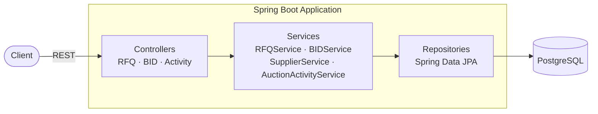
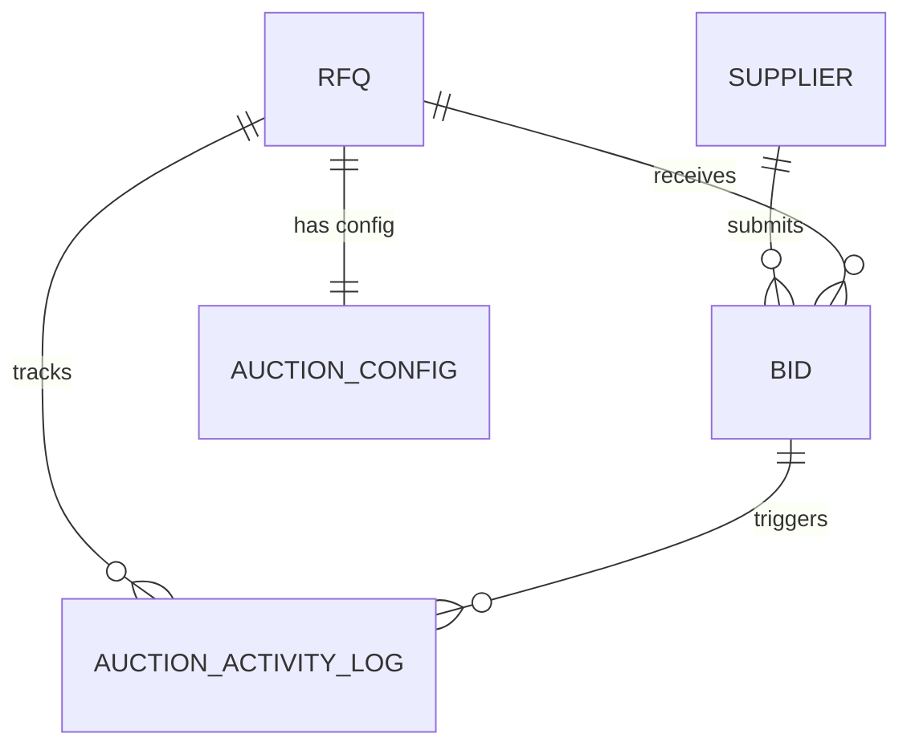

# Shipping Wars


A reverse-auction platform for freight procurement — shippers post RFQs, suppliers place competitive bids, and the platform auto-extends auction windows based on configurable trigger rules.

---

## 📐 Design Documentation

### [High-Level Design →](docs/hld.md)

Architecture overview of the system — layers, flows, concurrency strategy, and tech stack.



**Key flows covered:**
- `POST /api/rfqs` — Create RFQ with auction config
- `POST /api/rfqs/{refId}/bids` — Submit bid with validation, optimistic locking, auto-extension, and activity logging
- `GET /api/rfqs/{refId}/activity` — Full auction audit trail

---

### [Database Schema Design →](docs/schema-design.md)

All 5 tables, column definitions, constraints, relationships, and key design decisions.



**Tables:** `supplier` · `rfq` · `auction_config` · `bid` · `auction_activity_log`

---

## 🚀 Quick Start

```bash
# Prerequisites: Java 23, PostgreSQL running on localhost:5432
# Create database: shipping-wars

mvn spring-boot:run
```

API docs available at **http://localhost:8080/swagger-ui.html**

---

## 📡 API Endpoints

| Method | Endpoint | Description |
|--------|----------|-------------|
| `GET` | `/api/rfqs` | List all RFQs |
| `GET` | `/api/rfqs/active` | List active RFQs |
| `GET` | `/api/rfqs/{refId}` | Get RFQ by reference ID |
| `POST` | `/api/rfqs` | Create a new RFQ |
| `GET` | `/api/rfqs/{refId}/bids` | List bids for an RFQ |
| `POST` | `/api/rfqs/{refId}/bids` | Submit a bid |
| `GET` | `/api/rfqs/{refId}/activity` | Get auction activity log |
