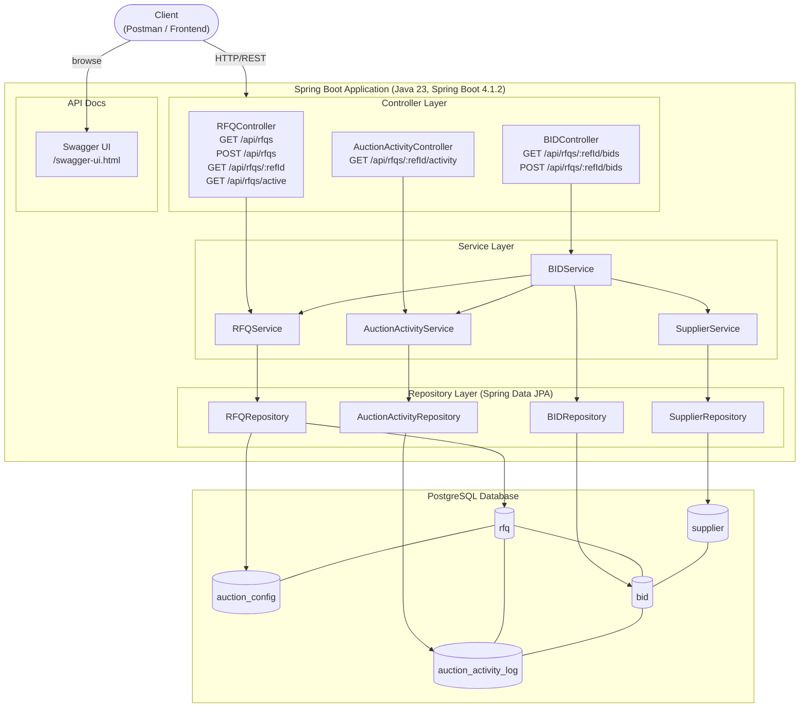
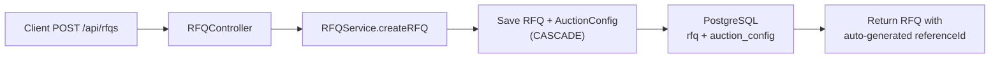
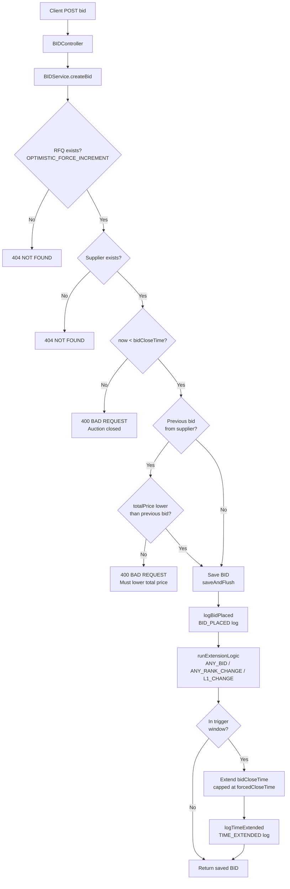

# Shipping Wars — High-Level Design (HLD)

## System Overview

**Shipping Wars** is a reverse-auction platform for freight procurement. Shippers post RFQs (Requests for Quotation), suppliers place competitive bids, and the platform automatically extends auction windows based on configurable trigger rules to drive optimal pricing.

---

## Architecture Diagram



---

## Layer Breakdown

### 1. Controller Layer
Thin REST layer — validates input, delegates to services, returns HTTP responses.

| Controller | Base Path | Responsibility |
|---|---|---|
| `RFQController` | `/api/rfqs` | CRUD for RFQs; fetch all, active, or by reference ID |
| `BIDController` | `/api/rfqs/{refId}/bids` | Submit and list bids for an RFQ |
| `AuctionActivityController` | `/api/rfqs/{refId}/activity` | Fetch the audit log for an RFQ |

### 2. Service Layer
All business logic lives here. Services are transactional and orchestrate cross-entity operations.

| Service | Key Responsibilities |
|---|---|
| `RFQService` | Create RFQ + AuctionConfig; fetch active RFQs; `findForBidSubmission` with lock |
| `BIDService` | Validate timing, validate improvement over previous bid, run auction extension logic, trigger activity logging |
| `SupplierService` | Supplier lookup by ID |
| `AuctionActivityService` | Write `BID_PLACED` and `TIME_EXTENDED` audit log entries |

### 3. Repository Layer
Spring Data JPA repositories with custom JPQL queries.

| Repository | Notable Queries |
|---|---|
| `RFQRepository` | `findByReferenceId` (with `JOIN FETCH auctionConfig`), `findActiveRFQs`, `findForBidSubmission` (optimistic force-increment lock) |
| `BIDRepository` | `findByRfqReferenceIdWithSupplier`, `findLatestBidsByRFQ`, `findLatestByRfqAndSupplier` |
| `SupplierRepository` | Standard `findById` |
| `AuctionActivityRepository` | `findByRfqReferenceIdWithBid` (with `JOIN FETCH bid → supplier`) |

---

## Core Flows

### POST /api/rfqs — Create RFQ



### POST /api/rfqs/:refId/bids — Submit Bid



---

## Auction Extension Logic

| Trigger Type | Extension fires when… |
|---|---|
| `ANY_BID` | Any bid lands within `triggerWindowMinutes` of close |
| `ANY_RANK_CHANGE` | The supplier ranking order shifts after the new bid |
| `L1_CHANGE` | The leading (lowest total price) supplier changes |

> **Hard cap:** `bidCloseTime` can never exceed `forcedCloseTime`, regardless of how many extensions occur.

---

## Concurrency Strategy

| Mechanism | Where used | Purpose |
|---|---|---|
| **Optimistic Lock** (`@Version`) | `RFQ.version` | Hibernate increments the version on every flush; detects concurrent writes to the same RFQ row |
| **`OPTIMISTIC_FORCE_INCREMENT`** | `RFQRepository.findForBidSubmission` | Forces a version bump even if no field on the RFQ itself changes, ensuring any concurrent bid transaction that loaded the same RFQ will fail with `OptimisticLockingFailureException` |
| **`@Retryable`** (`maxRetries=3, delay=100ms`) | `BIDService.createBid` | On a version conflict the transaction is transparently retried up to 3 times before returning an error to the client |
| **`@Transactional`** | `BIDService.createBid` | Entire bid → save → extend → log pipeline runs in one atomic transaction; version check happens at commit time |

---

## Technology Stack

| Layer | Technology |
|---|---|
| Language | Java 23 (preview features enabled) |
| Framework | Spring Boot 4.1.2 |
| Web | Spring Web MVC (`spring-boot-starter-webmvc`) |
| Persistence | Spring Data JPA + Hibernate (`spring-boot-starter-data-jpa`) |
| Database | PostgreSQL 5432 (`shipping_wars`) |
| Validation | Jakarta Bean Validation (`spring-boot-starter-validation`) |
| Boilerplate | Lombok |
| API Docs | SpringDoc OpenAPI 3.2.0 (Swagger UI) |
| Build | Maven |
| DDL strategy | `spring.jpa.hibernate.ddl-auto=update` |
| Timezone | All timestamps UTC (`hibernate.jdbc.time_zone=UTC`) |

---

## Project Structure

```
src/main/java/com/shipping/wars/shipper/
├── controller/
│   ├── RFQController.java
│   ├── BIDController.java
│   └── AuctionActivityController.java
├── service/
│   ├── RFQService.java
│   ├── BIDService.java
│   ├── SupplierService.java
│   └── AuctionActivityService.java
├── repository/
│   ├── RFQRepository.java
│   ├── BIDRepository.java
│   ├── SupplierRepository.java
│   └── AuctionActivityRepository.java
├── entity/
│   ├── RFQ.java
│   ├── AuctionConfig.java
│   ├── BID.java
│   ├── Supplier.java
│   ├── AuctionActivityLog.java
│   ├── TriggerType.java       (enum)
│   └── EventType.java         (enum)
└── dto/
    ├── CreateRfqRequest.java
    └── CreateBidRequest.java
docs/
├── hld.md                     ← this file
└── schema-design.md
```

---

## API Reference Summary

| Method | Endpoint | Description |
|---|---|---|
| `GET` | `/api/rfqs` | List all RFQs |
| `GET` | `/api/rfqs/active` | List currently active RFQs |
| `GET` | `/api/rfqs/{refId}` | Get single RFQ by reference ID |
| `POST` | `/api/rfqs` | Create a new RFQ |
| `GET` | `/api/rfqs/{refId}/bids` | List all bids for an RFQ |
| `POST` | `/api/rfqs/{refId}/bids` | Submit a bid for an RFQ |
| `GET` | `/api/rfqs/{refId}/activity` | Get auction activity log for an RFQ |
| `GET` | `/swagger-ui.html` | Interactive API docs (SpringDoc) |

