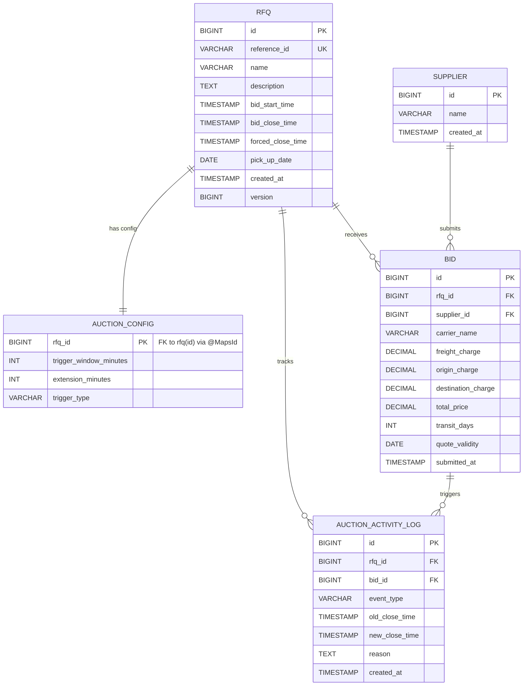

# Shipping Wars — Database Schema Design

## Entity-Relationship Diagram



---

## Table Definitions

### `supplier`
Represents a freight carrier / supplier participating in auctions.

| Column | Type | Constraints | Notes |
|--------|------|-------------|-------|
| `id` | `BIGINT` | PK, AUTO_INCREMENT | |
| `name` | `VARCHAR` | | Display name |
| `created_at` | `TIMESTAMP` | NOT NULL | Set by `@CreationTimestamp` |

---

### `rfq`
Request for Quotation — the core auction entity.

| Column | Type | Constraints | Notes |
|--------|------|-------------|-------|
| `id` | `BIGINT` | PK, SEQUENCE (`rfq_id_seq`, allocationSize=1) | |
| `reference_id` | `VARCHAR` | NOT NULL, UNIQUE, IMMUTABLE | Auto-generated as `RFQ-XXXX` via `@PrePersist` |
| `name` | `VARCHAR` | NOT NULL | |
| `description` | `TEXT` | nullable | |
| `bid_start_time` | `TIMESTAMP` | NOT NULL | UTC instant |
| `bid_close_time` | `TIMESTAMP` | NOT NULL | Mutable — extended by auction triggers |
| `forced_close_time` | `TIMESTAMP` | NOT NULL | Hard ceiling; `bid_close_time` never exceeds this |
| `pick_up_date` | `DATE` | nullable | UTC date, serialised as `yyyy-MM-dd` |
| `created_at` | `TIMESTAMP` | NOT NULL | Set by `@CreationTimestamp` |
| `version` | `BIGINT` | | Optimistic lock counter (`@Version`) |

**Check Constraints**

| Name | Constraint |
|------|-----------|
| `chk_rfq_bid_close_time` | `bid_start_time < bid_close_time` |
| `chk_rfq_forced_close_time` | `bid_close_time <= forced_close_time` |

---

### `auction_config`
One-to-one extension of `rfq` that holds auction extension rules.

| Column | Type | Constraints | Notes |
|--------|------|-------------|-------|
| `rfq_id` | `BIGINT` | PK + FK → `rfq(id)` | Shared PK via `@MapsId` |
| `trigger_window_minutes` | `INT` | `>= 0` | Time window before close in which a bid triggers an extension |
| `extension_minutes` | `INT` | `>= 0` | Minutes added to `bid_close_time` on a trigger |
| `trigger_type` | `VARCHAR` | | Enum: `ANY_BID`, `ANY_RANK_CHANGE`, `L1_CHANGE` |

**`trigger_type` enum values**

| Value | Behaviour |
|-------|-----------|
| `ANY_BID` | Every bid placed within the trigger window extends time |
| `ANY_RANK_CHANGE` | Extend only when supplier rankings shift |
| `L1_CHANGE` | Extend only when the lowest-price (L1) supplier changes |

---

### `bid`
A supplier's price submission against an RFQ.

| Column | Type | Constraints | Notes |
|--------|------|-------------|-------|
| `id` | `BIGINT` | PK, AUTO_INCREMENT | |
| `rfq_id` | `BIGINT` | FK → `rfq(id)`, NOT NULL | |
| `supplier_id` | `BIGINT` | FK → `supplier(id)`, NOT NULL | |
| `carrier_name` | `VARCHAR` | | Carrier chosen by supplier |
| `freight_charge` | `DECIMAL(15,2)` | NOT NULL | |
| `origin_charge` | `DECIMAL(15,2)` | NOT NULL | |
| `destination_charge` | `DECIMAL(15,2)` | NOT NULL | |
| `total_price` | `DECIMAL(15,2)` | NOT NULL | Derived: `freight + origin + destination` (set in service) |
| `transit_days` | `INT` | NOT NULL, `>= 0` | |
| `quote_validity` | `DATE` | NOT NULL | Last date the quote remains valid |
| `submitted_at` | `TIMESTAMP` | NOT NULL | Explicitly set to `Instant.now()` at submission time |

> **Subsequent bid rules** — A supplier may re-bid on the same RFQ only if the new bid lowers `total_price` compared to their previous bid.

---

### `auction_activity_log`
Immutable audit trail of every significant auction event.

| Column | Type | Constraints | Notes |
|--------|------|-------------|-------|
| `id` | `BIGINT` | PK, AUTO_INCREMENT | |
| `rfq_id` | `BIGINT` | FK → `rfq(id)`, NOT NULL | |
| `bid_id` | `BIGINT` | FK → `bid(id)`, nullable | Null for non-bid events (e.g. `AUCTION_CLOSED`) |
| `event_type` | `VARCHAR` | | Enum: `BID_PLACED`, `TIME_EXTENDED`, `AUCTION_CLOSED` |
| `old_close_time` | `TIMESTAMP` | nullable | Populated only for `TIME_EXTENDED` |
| `new_close_time` | `TIMESTAMP` | nullable | Populated only for `TIME_EXTENDED` |
| `reason` | `TEXT` | nullable | Human-readable description of why the event occurred |
| `created_at` | `TIMESTAMP` | NOT NULL, IMMUTABLE | Set by `@CreationTimestamp` |

**`event_type` enum values**

| Value | When logged | `reason` example |
|-------|-------------|-----------------|
| `BID_PLACED` | Every accepted bid | `"Bid placed by supplier Maersk — total: 5200.00, transit days: 14"` |
| `TIME_EXTENDED` | Auction window pushed out | `"Auction extended due to L1_CHANGE — from 2026-11-01T10:00:00Z to 2026-11-01T10:05:00Z"` |
| `AUCTION_CLOSED` | Auction ends | _(future)_ |

---

## Relationships Summary

```
supplier (1) ──────────── (N) bid
rfq      (1) ──────────── (1) auction_config
rfq      (1) ──────────── (N) bid
rfq      (1) ──────────── (N) auction_activity_log
bid      (1) ──────────── (N) auction_activity_log
```

---

## Key Design Decisions

| Decision | Rationale |
|----------|-----------|
| `rfq.reference_id` auto-generated as `RFQ-XXXX` | Stable, human-readable external identifier; immutable after creation |
| `auction_config` shares PK with `rfq` via `@MapsId` | True 1-to-1 — avoids a surrogate key and enforces uniqueness at DB level |
| `bid.total_price` stored (not computed) | Enables efficient sorting/ranking queries without re-computing on every read |
| `rfq.version` for optimistic locking | Guards against concurrent writes to `bid_close_time` at the ORM level |
| `forced_close_time` as hard ceiling | Prevents unbounded auction extensions via repeated trigger events |
| `auction_activity_log.bid_id` nullable | Allows logging non-bid events (`AUCTION_CLOSED`) without a dummy bid row |
| All timestamps as `TIMESTAMP` (UTC `Instant`) | Timezone-neutral; serialised and compared consistently across services |

